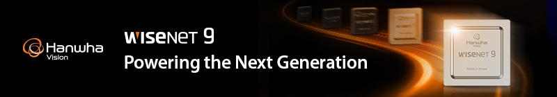

# Hanwha Vision Labs

Hanwha Vision provides network cameras, video recorders, and video analytics solutions for security and business intelligence. Hanwha Vision Labs is where we share the tools and documentation that developers need to build on our products.

Here you can find SDKs, API documentation, protocol specifications, and code samples to help you:

- Build applications that run on or work with Hanwha Vision devices.
- Integrate Hanwha Vision products with your own systems and services.

## Documentation

- [Product Integration Documentation](https://hanwhavisionlabs.github.io/product-integration-docs/): Guides for integrating Hanwha Vision products with your own systems and services.
- [OpenPlatform SDK Documentation](https://hanwhavisionlabs.github.io/opensdk-docs/): Programming guides, API references, sample applications, and supported devices.
